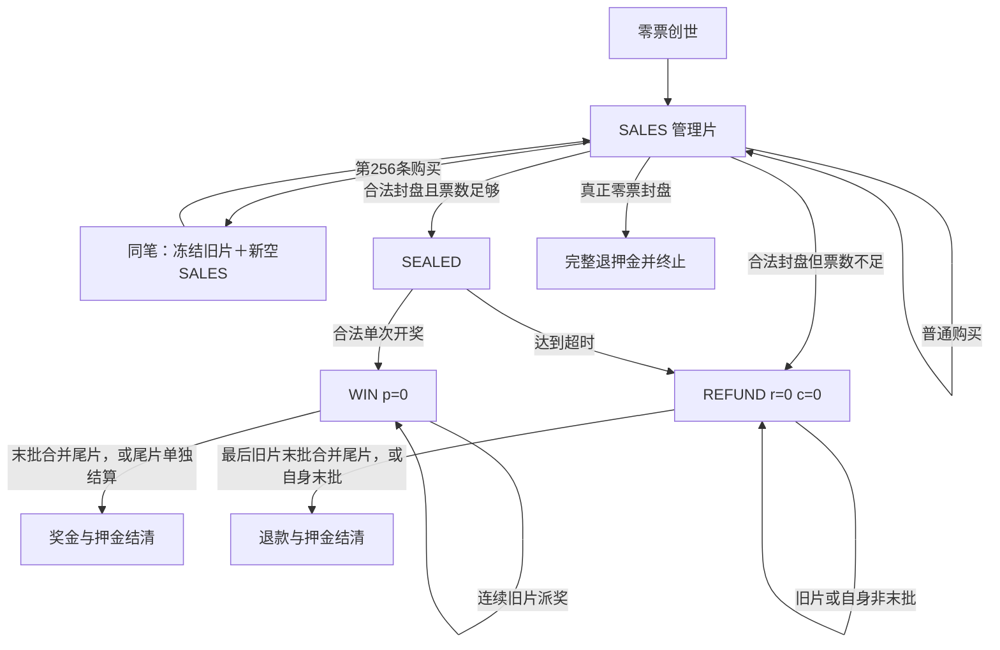

# 滚动分片首版实现规格

状态：SOURCE_IMPLEMENTATION / NOT_RUN。基线为[设计稿](ROLLING-ACTIVE-SHARD-DRAFT.md)，实现位于 `experiments/rolling/`。不改变现行 V2.0.2/Profile、线上网页或 Indexer。此文冻结账本布局、调用、接口和迁移规则；源码交付不代表已编译或可承载资金。**源码候选已同步本版规则；编译、离线脚本引擎执行与JS单测已完成，共识/acceptance与网络验证仍为NOT_RUN**，记录见[VALIDATION.md](../experiments/rolling/VALIDATION.md)，计划见第8节。

## 1. 已定范围

五类模板为 sales、sealed、win、refund、frozen；没有独立 C 或退款片。沿用设计稿的金额、容量、游标与费帽。最后一片奖池低于3 KAS（含空片）时，随最后一个旧片的末笔派奖／退款一起结清，不再设单独的空管理片退出；WIN不保存中奖票号。标准客户端出资与持票同公钥；协议不额外绑定二者。资金金额、费用、DAA 使用 bigint，传输为十进制字符串。

编译器固定为官方发布包 SilverScript 1.0.1，对应源码提交 `a17db2c7c95cf9f12f8e1264b21f32a8552af8df`，依赖Kaspa 2.1.0。来源与本地安装身份见[toolchain.json](../experiments/rolling/toolchain.json)。该包内部仍声明语言／artifact编译器版本0.1.0，因此现有`pragma silverscript ^0.1.0`与artifact版本检查保持；不能把发行包版本直接写成语言pragma。原生规则推导仍保留原有rusty-kaspa `cfafeb4c093fa37a303f1b9f19c58f986b870ce3`的出处，升级到2.1.0后的实际编译、预算与目标节点兼容尚未验证。异构账本使用显式P2SH/template/auth/cov检查，不使用同质State声明宏代替。

## 2. 账本布局与 ABI

### 账本数据区

偏移从数据区第0字节起，区间左闭右开。多字节整数为固定宽度小端非负值；公钥和哈希为32字节原始字节；不使用变长整数、位压缩或填充。

| 字段 | 编码 | 检查 |
|---|---|---|
| role | 1B | 管理0x01，冻结0x00，其余拒绝 |
| N、p、r、c | LE16 | N≤256；p、r≤N，mergeTail时存续状态须p<N／r<N；c按退款批次与目录范围检查 |
| ticketCap、minTickets | LE32 | 3≤minTickets≤ticketCap≤10,000,000 |
| 索引与目录累计终点 | LE32 | 严格递增、区间连续，T≤ticketCap |
| ticketPrice | LE64 | 整数sompi，满足最低票价与金额上界 |
| closeEligibleDaa | LE64 | 合法DAA范围，加法检查溢出 |
| 公钥、冻结脚本哈希 | 32B | 公钥按P2PK规则使用；哈希匹配完整redeem script |

管理模板公共头为[0,59)：[0,1) role，[1,33) ownerKey，[33,41) ticketPrice，[41,45) ticketCap，[45,49) minTickets，[49,57) closeEligibleDaa，[57,59) N。

| 模板 | 公共头之后的字段 | 头部长度H |
|---|---|---:|
| sales、sealed | 无 | 59 |
| win | [59,91) winnerKey；[91,93) p | 93 |
| refund | [59,61) r；[61,63) c | 63 |
| frozen | 不使用公共头，只有[0,1) role | 1 |

索引占`[H, H+36N)`，每项[0,32)为冻结脚本哈希、[32,36)为全局累计终点；目录从`H+36N`开始，每条[0,4)为本地累计终点、[4,36)为买家公钥。解码要求`length ≥ H+36N`且余下长度是36的整数倍；N=256时目录必须为空；冻结数据区恰为9,217B。

最大数据区出现在N=255、本地255条时：sales／sealed 18,419B，win 18,453B，refund 18,423B。sales→sealed布局不变；进入win／refund时插入对应字段，并按新H原样继承索引和目录。不加入旧KW21的magic、phase、sold、purchaseCount。

尾片合并条件由账本推导，不接受声明：

```text
mergeTail = N > 0 且 localTickets × ticketPrice < 300,000,000 sompi
```

localTickets取原始目录末条累计终点，不能用退款后剩余票款重算合并条件。`mergeTail=true`时，存续WIN的p必须小于N，存续REFUND的r必须小于N；达到末片完成条件的交易必须直接终止管理者，不能先产生完成游标后再尝试退出。REFUND全轮原始票数必须大于0；r=N仅适用于非合并、自身仍有未退记录的状态。

### 脚本帧与ABI

所有构造器只有 `byte[] initialLedger`，可变状态只有 `byte[] ledger`。帧为 `0x6b || canonicalPush(ledger) || tail`，tail 首字节为0x6c；真实编译产物必须证明该形状。长度1～75使用直接长度push，76～255使用PUSHDATA1，256～65535使用PUSHDATA2。新创世59字节及空REFUND 63字节不能沿用旧80字节账本的PUSHDATA1特例。ScriptNum是有符号编码，128～255的长度字节从更宽的正数编码截取，不能直接按1字节ScriptNum转换；outpoint的LE32也从有足够符号空间的宽编码取低4字节。

所有入口名为spend。参数顺序如下；其后是编译器生成的4字节dispatch tag，最后push本输入完整redeem script。int采用非负最小ScriptNum，byte[]采用数据push；不得混淆账本LE字段与ScriptNum。tag从固定ABI编译产物读取并纳入Profile，不猜测具体数值。

| 模板 | spend参数，按顺序 |
|---|---|
| sales | action:int, originTxId:byte[32], originIndex:int, ownTailBytes:int, nextTail:byte[], data:byte[] |
| sealed | action:int, ownTailBytes:int, nextTail:byte[], data:byte[] |
| win | action:int, ownTailBytes:int, targetSizes:byte[] |
| refund | action:int, ownTailBytes:int, targetSizes:byte[] |
| frozen | managerRedeemBytes:int, managerTailBytes:int |

| action | 编号 | 参数与效果 |
|---|---:|---|
| BUY | 1 | data=LE32(q)\|\|buyerKey，共36B；普通购买nextTail为空，满片时nextTail为冻结程序tail |
| CLOSE | 2 | data空；非空进入SEALED/REFUND，nextTail为对应tail；真正空轮退出nextTail空 |
| DRAW | 4 | data=PASS-A 240B\|\|LE16(j)\|\|LE16(i)\|\|LE32(redeem长度)\|\|中奖旧片redeem；j=N时长度0且不附原文；nextTail为WIN |
| TIMEOUT | 9 | data空，nextTail为REFUND |
| PAY_OLD | 20 | targetSizes为实际k个冻结输入redeem长度的LE32数组，k从输入总数减1推导；mergeTail且p+k=N时为终局批 |
| PAY_SELF | 21 | targetSizes空；p=N且非mergeTail（N=0或尾片奖池≥3 KAS），不消费冻结片 |
| — | 22、23 | 停用（原MERGE_TAIL、EMPTY_EXIT），由PAY_OLD／REFUND_OLD终局批取代；编号不复用 |
| REFUND_OLD | 30 | targetSizes恰4B，r<N，固定退32条；mergeTail时S_(N−1)第8批同时退尾片并终止 |
| REFUND_SELF | 31 | targetSizes空，r=N且非mergeTail，按剩余记录最多32条，可追加普通补费 |

DRAW种子输入固定162B：ASCII `KASWIN_ROLLING_DRAW_V1`（22B）\|\| CID（32B）\|\| 输入0 outpoint txid（32B）\|\| LE32(index) \|\| LE64(d+100) \|\| PASS-A目标块哈希（32B）\|\| 序列承诺（32B），输出32B BLAKE2b。抽样沿用 `KASWIN_V2_SAMPLE`、8字节零计数器和56位拒绝规则。

不接受fee、k、p_next、r_next、c_next、执行奖励公钥等重复声明。费用来自实际输入输出差额；执行者/找零输出按固定位置读取并验证版本0 Schnorr P2PK格式。前像长度是定位提示，不是可信状态。

冻结输入从真实输入0见证末端提取管理redeem，验证实际P2SH、canonical帧、管理角色、固定WIN/REFUND模板哈希及自身零后继授权。管理输入从目标输入末端提取完整冻结redeem，认证实际P2SH及索引中的完整脚本哈希，再读取9217B账本。管理账本在输入0中只携带一份，每个冻结输入各携带自己的账本，双方不在见证里复制对方的完整原文。最大16片派奖的账本数据区合计为`18,453 + 16 × 9,217 = 165,925B`；完整交易还须计入程序、其他见证和交易字段。开奖读取未消费的中奖片例外：其完整前像必须由DRAW见证提供并匹配索引承诺。

编译顺序：win/refund → sealed/frozen → sales。`.sil.in`是带公共片段和固定哈希占位符的源码输入，prepare工具只展开源码，不调用编译器。每个下游源必须使用实际产物的template hash，拒绝全零占位。首次候选Profile由五个展开源SHA256、template hash及dispatch tag按固定顺序派生，域为`KASWIN_ROLLING_PROFILE_V1`；现行Profile不得复用。

## 3. 逐转换检查表

每笔version=1；管理输入固定0。完整检查全部输入/输出数量、金额、脚本、binding和资金守恒。普通资金无CID，最多8个；普通输出无binding；所有状态后继authorizing_input=0。冻结输入只能是本轮CID，且不授权后继；普通资金签名由共识验证，标准客户端沿用SIGHASH_ALL与本地验签。

| 转换 | 核心前置与不变量 | 后继/付款 |
|---|---|---|
| 创世 | 合法配置、N=0、空目录、4 KAS、origin=普通输入0 | 唯一同CID管理输出0；登记0.2 KAS为可选普通付款；找零最后 |
| BUY | canonical genesis CID；N<256；q>0且T+q≤cap；原数据前缀不改 | 非满片追加1条；满片冻结256条并把哈希和全局终点追加索引，新管理片N+1、本地空；押金仅在管理片 |
| CLOSE | cap满、记录满或满足原绝对DAA封盘语义 | T=0完整退押金；0<T<min转REFUND(r=c=0)；否则SEALED；票权不改 |
| DRAW | 实际SEALED outpoint/DAA，age≥100，PASS-A及56位单次拒绝抽样，j/i相邻区间证明 | WIN保存winnerKey、p=0，其余数据和管理金额不变；外部出费 |
| TIMEOUT | SEALED age≥432000 | REFUND(r=c=0)；外部出费；不改变票权 |
| PAY_OLD | 1≤k≤16；连续p起k片；每个真实outpoint不同、同CID、完整原票款匹配；p+k≤N | 非终局：管理输出0金额不变、p+=k；赢家=本批票款−k KAS−fee；执行者=k KAS。mergeTail且p+k=N为终局：赢家=本批票款＋本地票款−k KAS−fee；创建者4 KAS；执行者k KAS；终止 |
| PAY_SELF | p=N且非mergeTail | 赢家=本地票款−1 KAS−fee；创建者4 KAS；执行者1 KAS；终止 |
| REFUND_OLD | r<N、c为0..224的32倍数；冻结余额=(T_r−Q(c))*price | 每条按增量票数退款并扣0.02 KAS；管理金额不变；前7批冻结同脚本减款、c+=32；末批销毁冻结、r+=1/c=0。mergeTail且r=N−1、c=224为终局：同时退本地全部m条（m≤2，各扣0.02 KAS）；创建者4 KAS；执行者=(32+m)×0.02 KAS−fee；终止 |
| REFUND_SELF | r=N且非mergeTail，c指自身未退记录；m=min(32,remaining) | 逐记录退款；非末批管理减票款并推进c；末批创建者3.98 KAS，额外0.02 KAS归费池；执行者含补费返还；终止 |

WIN派奖（PAY_OLD、PAY_SELF）费帽1 KAS；其余动作0.5 KAS。每条输出必须为正。标准找零为实际外部投入减本动作新增票款/押金/登记费及网络费；REFUND_SELF只有一个执行者输出合并补费返还，不额外找零。

### 固定输入输出布局

输入0为管理片；输入1～k为目标冻结片，按索引顺序排列；其后为普通资金。禁止混入其他本轮片、第二个管理片或其他CID输入；同哈希片每个位置对应一个不同outpoint。

| 动作 | 输入0之后 |
|---|---|
| BUY | 1～8个付款人资金 |
| CLOSE、DRAW、TIMEOUT | 1～8个执行人资金 |
| PAY_OLD | 恰好k个冻结片（1～16），无资金 |
| PAY_SELF | 无 |
| REFUND_OLD | 恰好1个冻结片S_r，无资金 |
| REFUND_SELF | 0～8个执行人补费资金 |

| 动作 | 输出顺序 | 数量 |
|---|---|---|
| BUY普通 | 0管理后继；可选1找零 | 1或2 |
| BUY换片 | 0新管理片；1冻结片；可选2找零 | 2或3 |
| CLOSE非空 | 0 SEALED／REFUND管理后继；可选1找零 | 1或2 |
| CLOSE空轮 | 0创建者押金；可选1找零 | 1或2 |
| DRAW、TIMEOUT | 0 WIN／REFUND管理后继；可选1找零 | 1或2 |
| PAY_OLD非终局 | 0管理后继；1赢家；2执行者 | 3 |
| PAY_OLD终局、PAY_SELF | 0赢家；1创建者押金；2执行者 | 3 |
| REFUND_OLD前7批 | 0管理后继；1冻结后继；2～33买家；34执行者 | 35 |
| REFUND_OLD第8批（非终局） | 0管理后继；1～32买家；33执行者 | 34 |
| REFUND_OLD终局（本地m条，0≤m≤2） | 0～31旧片买家；32～31+m本地买家；32+m创建者；33+m执行者 | 34+m，最多36 |
| REFUND_SELF非末批 | 0管理后继；1～m买家；m+1执行者 | m+2 |
| REFUND_SELF末批 | 0～m−1买家；m创建者；m+1执行者 | m+2 |

找零只出现在标明的最后可选位置，无余额时省略，不创建零金额占位。收款公钥相同也不合并不同角色的输出；买家退款按目录顺序逐条占位。公共输出上限及费用求和循环覆盖36个输出，各动作仍严格检查表内数量，不能因公共上限放宽而允许额外输出。合并退款终局不再生成任何管理／冻结后继，并完整返还4 KAS押金；独立自身退款末批仍返还3.98 KAS。

创世交易尚未执行新管理输出的脚本：其普通资金输入数量（1～8个，输入0确定origin）、登记付款、找零和费帽属于标准构建器／发现策略，不能声称由新管理脚本在创建时执行。后续sales入口用canonical genesis CID证明初始同CID输出组恰为规定的零票管理者；已存在轮次的输入输出限制则由实际被消费的管理脚本执行。

封盘客户端lockTime=closeEligibleDaa−1，序列0；cap/记录先满时lockTime=0。DRAW/TIMEOUT输入0相对序列分别100/432000，其余输入序列0；仅构造这些值不构成节点成熟或acceptance证据。其他交易元数据沿用原生v1构建器。

## 4. Indexer v1接口与原子持久化

路径前缀`/v1/rolling/{networkGenesis}/{profileId}`，只接受可信Profile白名单中的版本。金额/DAA/counter revision为规范十进制字符串，字节为小写hex；索引/游标为范围已检查整数。所有返回都是待客户端核验的数据，接口不授予消费权限。

- `PUT /preimages/{scriptHash}`：请求`{redeemScript}`；重算BLAKE2b/P2SH和受支持模板，已有键只允许字节完全相同。先作为候选保存，不能产生已接受状态。
- `GET /preimages/{scriptHash}`：返回原文及template角色；没有原文返回404，不用空账本替代。单对象限制250000B，HTTP层同时限制请求体。
- `GET /rounds/{cid}`：返回`{networkGenesis,profileId,cid,origin,revision,manager,frozen,acceptance}`；manager含outpoint、scriptHash、value、utxoDaa、module；frozen逐outpoint列出相同字段，不按地址/hash去重。具体p/r/c从认证原文解析。
- `GET /rounds/{cid}/history?cursor=...&limit=...`：稳定排序接受实例与撤销事件，分页最多100条；游标绑定network/Profile/CID和revision，失效返回409。历史记录不能替代当前节点UTXO。
- `GET /rounds/{cid}/export`：以NDJSON逐条导出固定revision的轮次、接受/撤销事件与原文，末尾必须有包含计数的`end`记录；中断流不能当作完整备份。导出成功不是备份恢复测试。

必须保存：网络genesis、Profile、创世origin与固定配置；全部冻结原文；最新管理原文；逐outpoint余额、消费关系及对应p或r、c；接受实例与撤销事件。原文按内容寻址，可同轮或跨轮共享；状态按CID与outpoint记录，票价等配置只从对应CID的管理原文取得。冻结原文也可从其换片交易重建（前255条在输入0管理账本，第256条来自BUY的data）。轮次结清前不得清理，归档不随节点裁剪删除。

恢复顺序：节点定位当前UTXO → 取原文 → 按Profile重建P2SH并核对 → 绑定CID、outpoint、金额、DAA及r／c与冻结余额后才开放操作。原文缺失时报告“缺少账本材料”，不按零票处理，也不显示为节点同步中。

写入只由已完成节点接受与协议解释的内部过程调用：原文持久化 → 校验预期旧revision/管理outpoint → 原子更新新管理者、被消费/新建冻结outpoint、逻辑索引映射和接受实例 → 推进扫描游标。失败不得留下新r/c配旧余额的半状态；重放幂等。实例键包含network/Profile/CID、txid、接受位置与见证摘要，不能仅用txid标识见证。撤销按接受实例反向应用，revision单调增长，原文保留，不能回滚revision后误命中旧缓存。

首版FileArchive采用单进程写入，小型当前快照与追加的revision日志分开保存；每次只写本笔事件，不重写整轮历史。撤销记录只保留原管理者和本笔消费／创建的冻结输出差量。原文、事件及派生receipt索引先落盘，最后原子替换快照；读者只暴露快照已发布的revision。中断留下的receipt索引不能作为权威，须匹配对应已发布事件，否则回退日志查询。外层扫描器仅在成功提交后推进扫描位置，包本身不启动扫描或服务。

每个非终局快照必须完整匹配当前管理状态对应的剩余冻结输出多重集合：WIN为[p,N)，REFUND为[r,N)，当前部分退款片按c余额，其余为完整余额。同哈希不同余额不能混配；同哈希同余额允许等价映射但outpoint不得重复。归档缺失和当前UTXO不齐分别报告，不降级为单片模型。

备份采用追加原文存储+带检查点的状态数据库备份；上线前须落实运维位置、备份周期和一次离线恢复演练。备份/网络服务部署不在本次源码交付中冒充完成。

## 5. 客户端约定

- **出资与签名**：标准客户端用同一钱包出资并登记为买家，找零退回该钱包。普通资金最多8个UTXO，不足时提示用户先整理钱包，不自动发起合并交易。保持SIGHASH_ALL与本地验签，签名前核对目录公钥、数量和找零。不提供代买或多人共同出资入口。
- **免钱包执行**：PAY_OLD、PAY_SELF、REFUND_OLD及不需补费的REFUND_SELF没有普通资金输入，可以不连接钱包执行。奖励地址由用户粘贴，或从已连接钱包读取；不为纯合约交易请求签名。需要补费时明确提示原因与金额，转入钱包签名路径，不静默追加输入。
- **地址解析**：完整解码地址，校验和、所选网络前缀、`Version::PubKey`及32字节载荷均须符合，P2SH等其他类型一律拒绝。格式检查不证明私钥所有权，网络仍以节点genesis核对。提交前把奖励脚本反解为地址，与用户确认的地址比对一致。
- **逐笔主动执行**：派奖／退款每笔由用户发起和确认，完成一笔不自动提交下一笔。构建器在1～16片内选择满足mass与费帽的最大k，k=1仍不满足则停止。开奖人没有后续专属执行权，任何人都可以接手。
- **进度展示**：派奖显示p/N；退款在旧片阶段显示已退记录`256×r+c`，r=N后c指管理片自身。到期显示“可封盘”而不是“已封盘”；只有验证完整随机证明且x≥limit后，才显示“抽样拒绝，等待超时退款”。进度一律以节点接受状态为准，广播、区块包含或查询为空都不是完成证据。

## 6. 新旧版本并存

新建轮次只有显式启用新Profile后才走rolling。已有V2.0.2轮次继续绑定旧codec、ABI、构建器及预算，不能原地升级或把资金自动迁移到新CID。受信注册表以完整Profile ID精确路由，不按页面当前版本、phase标签或账本长度猜测。未知Profile只显示“不支持”，不尝试旧解析器兜底。

原型仅输出离线交易草案和候选归档操作，不提供签名/广播/生产启用入口。正式集成须由本地可信配置固定编译产物摘要、来源、ABI和新Profile，验证资源后才启用创建；不能信任远端上传的`approved:true`。

## 7. 资源与交付边界

资源输入必须是新Profile真实编译产物及逐输入VM消耗，不能继承旧actionBudget系数。最大管理状态为N=255、本地255条，而不是空的S256。固定32条退款和k=1派奖是退出可行性的必要条件。16为协议上限，构建器可减小连续批量；硬限制不满足时停止，不减买家退款或挪用押金。

| 场景 | 必须覆盖的组合 |
|---|---|
| 最后一次换片 | N=255、本地255条，追加第256条后产生S255冻结片与空S256 |
| 开奖 | 最大sealed数据区＋中奖旧片完整原文＋PASS-A；另覆盖中奖片在本地目录 |
| 16片派奖 | 最大win数据区＋16个不同outpoint的完整冻结输入（共17输入），含PAY_OLD终局批 |
| 旧片退款 | 最大refund状态的35／34输出；另外覆盖合并终局m=0／1／2的34／35／36输出、34个不同退款收款人、最低票价和费帽；两类状态分别测量，不能把最多2条本地记录的终局当作最大管理账本 |
| 自身结算 | N=0单片、尾片奖池≥3 KAS的PAY_SELF、REFUND_SELF小尾批及补费路径 |

新Profile接受购买资金前，必须证明所有可达状态都有可执行的结算路径。

## 8. 源码交付与状态机

源码入口：[experiments/rolling/README.md](../experiments/rolling/README.md)。五模板源码输入、公共校验片段、账本codec、全部动作构建、接受交易解释、Profile分流、奖励地址、mass／费用计算、文件归档、节点Full接受适配及HTTP接口均已写入原型目录；没有接入现行发布构建。具体文件职责见入口表。

**源码同步范围（NOT_RUN）**：

- WIN头部93B，p位于[91,93)，不保存t；sealed、win、frozen的帧核验与state编解码同步，最大数据区为18,453B。
- win／refund共用按原始本地票款低于3 KAS判断的合并条件，包含空尾片；合并状态禁止存续p=N／r=N。
- PAY_OLD允许最多16个连续旧片，终局批一并支付尾片并完整退押金；REFUND_OLD最后旧片第8批一并退本地0～2条记录和完整押金。
- 动作22、23在构建器与合约中停用；接受交易解释器按当前动作表拒绝。真正空轮继续由CLOSE退出。
- 公共合约输出上限、费用循环和构建器上限统一覆盖36个输出；每个分支仍检查精确布局。
- state.test.mjs已更新；transactions.test.mjs新增终局金额、输出数量、3 KAS边界、原始合并条件、停用动作及篡改输出的JS用例。交易测试使用明确标注的合成脚本帧，只检查链下规则，不替代真实合约或acceptance证据。



编解码、链下交易与文件归档的JS用例已于2026-11-13执行（23/23）；真实VM、最大资源与网络检查计划见[RESOURCE-AND-VM-PLAN.md](../experiments/rolling/RESOURCE-AND-VM-PLAN.md)。新增原型不是生产接入：节点连接由宿主提供、归档只允许单写入进程，真实编译哈希／tag／Profile及预算仍须执行取得。

2026-11-13已用固定SilverScript 1.0.1编译五个模板（`experiments/rolling/compile.mjs`），得到真实字节码、模板哈希、dispatch tag和候选Profile ID，并用`measure.mjs`按真实产物核算体积类交易mass；两次从零重建字节一致。编译暴露三类源码问题并已改写：`return`后不能接括号表达式、不允许提前`return`、辅助函数内联使栈绑定超过共识上限244，因此源码改为入口一次性解码头部、辅助函数显式传参并用`{}`限定作用域，`U16/U32/U63`为`prepare-sources.mjs`展开的无栈表达式宏。语义由人工等价改写，未经VM验证。随后做了不改协议的代码尾压缩（循环上限按各合约实际输入/输出数设定、冻结片原文按固定格式解析、退款两个32次循环合并为一份、分支内重复的状态输出/找零合并为一次校验、去掉被角色函数覆盖的范围检查、`ZERO`改用局部变量引用），代码尾为sales 3,236B、sealed 3,382B、win 10,463B、refund 10,876B、frozen 492B（压缩前依次为8,129/7,291/19,035/23,664/492），ABI与dispatch tag不变。此后已在真实`kaspa-txscript` 2.1.0引擎下离线执行48个基线与3,268个单点变异并实测各输入计算预算，按实测预算重算的mass均未超限（范围与边界见[VALIDATION.md](../experiments/rolling/VALIDATION.md)）；共识/acceptance、资金输入签名、网络与批准仍为NOT_RUN；`measure.mjs`仍按预算0报价，其compute项只是体积下界。
